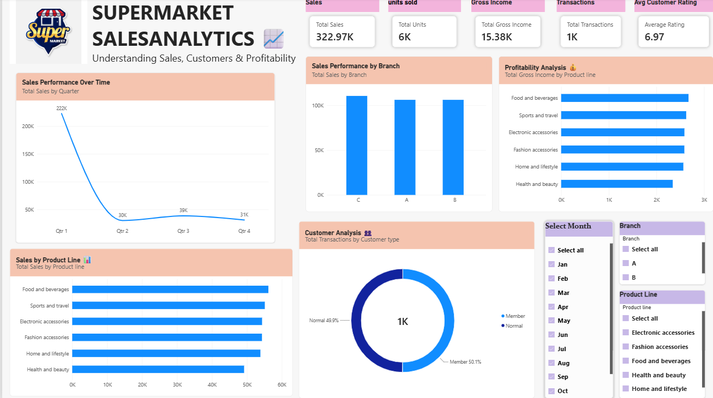

# Supermarket Sales Analytics Dashboard

## Overview
An interactive Power BI dashboard built to analyze supermarket
sales performance, product categories, branches, and customer behavior.

## Tools Used
- Microsoft Power BI Desktop
- Power Query
- DAX

## Dashboard Features
- Total sales and transaction KPIs
- Sales trends over time
- Sales by product line
- Branch performance comparison
- Gross income analysis
- Customer type analysis
- Interactive month, branch, and product line filters

## Dataset
This project uses a publicly available sample supermarket sales dataset.
It is an educational project and does not represent a specific
supermarket company's actual performance.

## Dashboard Preview

## Learning Outcomes
- Data preparation
- DAX measures
- Data visualization
- Interactive dashboard design
